# Chat POO

Sistema de chat em tempo real desenvolvido em Python aplicando os pilares de Programação Orientada a Objetos (**Abstração**, **Encapsulamento**, **Herança** e **Polimorfismo**), com comunicação via WebSockets e persistência no Supabase.

[Baixar Executáveis (Releases)](../../releases)

## Estrutura do Projeto

```text
chat-poo/
├── backend/
│   ├── main.py            # Servidor FastAPI e gerenciamento de WebSockets
│   ├── models.py          # Modelos de domínio e regras de negócio (POO)
│   └── requirements.txt   # Dependências do servidor
├── client/
│   ├── app.py             # Interface gráfica (Tkinter) e cliente WebSocket
│   ├── models.py          # Modelos do cliente e renderização polimórfica (POO)
│   └── requirements.txt   # Dependências do cliente
├── .env.example           # Modelo de variáveis de ambiente
└── .gitignore
```

## Diagrama de Classes

```mermaid
classDiagram
    namespace Backend {
        class Usuario {
            <<abstract>>
            #nome: string
            +nome() string
            +pode_apagar_mensagem()* bool
        }

        class UsuarioComum {
            +pode_apagar_mensagem() bool
        }

        class Moderador {
            +pode_apagar_mensagem() bool
        }

        class Mensagem {
            #id: int
            #autor: Usuario
            #tipo_autor: string
            #conteudo: string
            +id() int
            +autor() Usuario
            +tipo_autor() string
            +conteudo() string
            +conteudo(novo_conteudo: string) void
            +to_dict() dict
        }
    }

    Usuario <|-- UsuarioComum : HERANÇA
    Usuario <|-- Moderador : HERANÇA
    Mensagem o-- Usuario : AGREGAÇÃO

    namespace Client {
        class UsuarioClient["Usuario"] {
            <<abstract>>
            #nome: string
            +nome() string
            +renderizar_botao_apagar(parent_frame, msg_id: int, callback_apagar, tk_module)* void
        }

        class UsuarioComumClient["UsuarioComum"] {
            +renderizar_botao_apagar(parent_frame, msg_id: int, callback_apagar, tk_module) void
        }

        class ModeradorClient["Moderador"] {
            +renderizar_botao_apagar(parent_frame, msg_id: int, callback_apagar, tk_module) void
        }

        class ChatApp {
            +usuario: Usuario
            +mensagens_widgets: dict
            +conectar() void
            +adicionar_mensagem(msg: dict) void
            +enviar_mensagem() void
            +solicitar_editar(msg_id: int) void
            +solicitar_apagar(msg_id: int) void
        }
    }

    UsuarioClient <|-- UsuarioComumClient : HERANÇA
    UsuarioClient <|-- ModeradorClient : HERANÇA
    ChatApp o-- UsuarioClient : AGREGAÇÃO
```



## Configuração de Ambiente (Backend)

1. Copie o arquivo de exemplo para criar seu `.env`:
   ```bash
   cp .env.example .env
   ```
2. Preencha as variáveis `SUPABASE_URL` e `SUPABASE_KEY` no arquivo `.env`.
3. Instale as dependências e inicie o servidor:
   ```bash
   pip install -r backend/requirements.txt
   uvicorn main:app --app-dir backend --reload
   ```

## Como Abrir o Cliente (Executáveis)

### Windows
- Dê 2 cliques em `ChatClient-Windows.exe`.

### Linux
- Abra o terminal na pasta do arquivo e execute:
  ```bash
  chmod +x ChatClient-Linux && ./ChatClient-Linux
  ```
